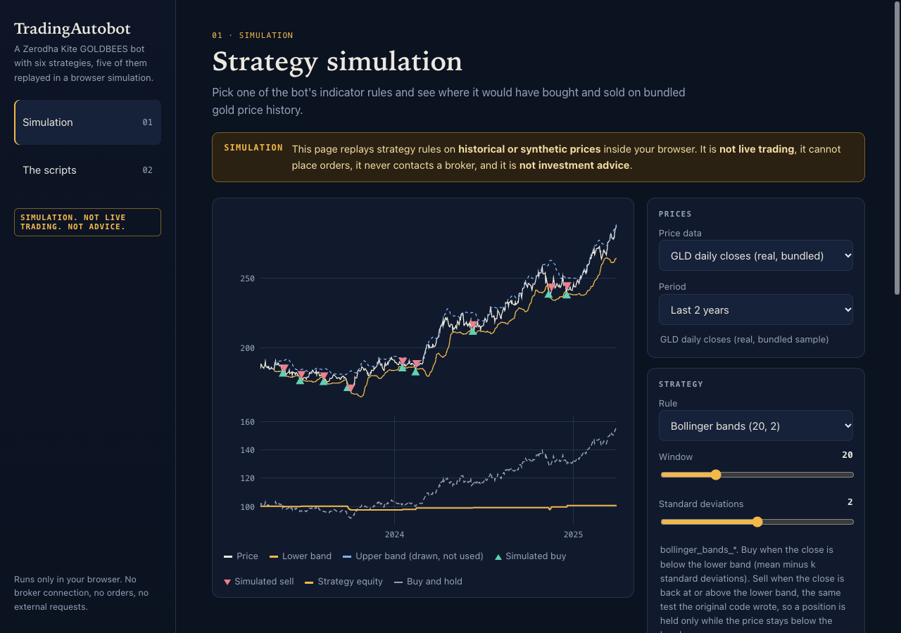

# TradingAutobot

A bot for trading **GOLDBEES** (a gold ETF on India's NSE) through the Zerodha Kite web API. It holds six buy/sell rules (moving average, Bollinger bands, standard deviation, envelope, Hull moving average, KNN) and, in its original form, buys one unit when any rule says buy and sells when any rule says sell. This repository also contains a browser simulation of five of the six rules.



> **The bot has not been run against a broker.** It needs a live Zerodha login and can place real orders. The numbers below come from an offline simulation and from running the signal functions on price history, not from live trading. Nothing here is investment advice.

## Try the demo

Open `docs/index.html` in any browser (double-click it; one self-contained file, no network requests). GitHub Pages is not enabled, so there is no hosted link.

The page is a **simulation**: it replays one rule at a time on historical or synthetic daily prices. It cannot place orders and never contacts a broker. You can change each rule's window and threshold, pick real GLD prices or a seeded random walk, choose same-bar or next-bar fills, add a cost per trade, and see every simulated trade.

## Run the bot

```bash
pip install -r requirements.txt
export KITE_ENCTOKEN=...        # your own Kite session token; never put it in a file
python main.py                  # dry run: prints what it would do
```

- `KITE_ENCTOKEN` is the `enctoken` value from your own logged-in kite.zerodha.com session. The code exits with a message if it is not set.
- **Orders are off by default.** `main.py` only prints `DRY RUN` unless you also `export KITE_PLACE_ORDERS=1`.
- The token expires when you log out of Kite.

## Scripts

| Script | What it does | Data | Measured result |
|---|---|---|---|
| `kiteapi.py` | Unofficial Kite client (`KiteApp`: candles, quotes, orders, positions, margins; `get_enctoken()` for a password login). | Zerodha API | Parses and imports; not run against Zerodha. |
| `StratDict.py` | Six buy/sell rule pairs plus `fetch_historical_data()` and `get_kite()`. Each rule takes a DataFrame with a `Close` column and answers for the latest row. | Candles passed in | Run offline on GLD daily closes: all six rules execute; results below. |
| `main.py` | Loop: when flat, buy 1 GOLDBEES if the first rule in the list says buy; when holding, sell if one says sell. Polls every 60 s. | Zerodha API | Not run live. The decision step (`decide`) and the dry-run order step were run offline. |

### Rule results on real prices (offline)

Calling the repaired functions on the last 500 GLD closes (2023-04-03 to 2025-03-31), at the latest bar: moving average buy, Bollinger sell, standard deviation sell, envelope sell, Hull moving average buy, KNN predicts "up" (k = 1, 0.3 s). `decide()` returned `('BUY', 'moving_average')` when flat and `('SELL', 'bollinger_bands')` when holding. Same answers on the last 1,000 closes.

### Simulation results (GLD daily closes, last 2 years = 500 closes, fills one bar after the signal, no costs)

GLD is a US-listed gold ETF, used as a stand-in because GOLDBEES data is not in the repository. The 5,123 closes (2004-11-18 to 2025-03-31) are copied from the Gate-2.0 data folder (`GLD_1d.csv`). Buy and hold over the same 500 closes: +55.74%.

| Rule (default parameters) | Strategy return | Closed trades | Time invested | Max drawdown |
|---|---|---|---|---|
| Moving average 50 / 200 | +52.93% | 0, plus 1 open | 60% | -8.12% |
| Bollinger bands 20, 2 | +0.46% | 9 | 3% | -2.60% |
| Standard deviation 20, 2 (returns) | +0.06% | 9 | 2% | -1.03% |
| Envelope 20, 5% | +1.72% | 1 | 0.4% | -0.18% |
| Hull moving average 20 | +59.20% | 43, plus 1 open | 51% | -6.27% |

Only the Hull rule ended ahead of holding, and only on this one 2-year window with these settings; with 43 trades and no costs, that says little about it. The 50/200 rule needs 200 bars of warm-up, so on 500 bars it bought once and never sold. The three band-style rules are in the market for a few percent of days because they only hold while the price is below a lower band.

On a seeded synthetic random walk (seed 42, 1,500 days) Bollinger 20/2 returned -2.65% and Hull 20 returned +31.79%, against +108.89% for holding. A random walk has no pattern to find, so any difference from holding there is luck plus costs.

The simulation page's numbers were checked against a separate Python implementation that calls the repo's own `StratDict.py` functions one bar at a time and runs its own backtest: 12 configurations (all five rules, different windows, both fill modes, costs, GLD and the synthetic series) matched on return, number of trades, sum of trade returns, time invested and open position.

## The strategies

- **Moving average (50/200).** Buy while the 50-bar mean of closes is above the 200-bar mean; sell when it is at or below.
- **Bollinger bands (20, 2).** Lower band = 20-bar mean minus 2 standard deviations. Buy when the close is below it; sell when it is back at or above it.
- **Standard deviation (20, 2).** Original rule compared the close with `-2 x rolling_std`, which can never be true for a price. Repaired reading: buy when the one-bar return is below minus 2 standard deviations of the last 20 returns; sell otherwise. This is an interpretation, not the original author's confirmed intent.
- **Envelope (20, 5%).** Lower envelope = 20-bar mean x 0.95. Buy below it, sell at or above it.
- **Hull moving average (20).** `WMA(2 x WMA(n/2) - WMA(n), sqrt(n))`. Buy when the close is above it, sell at or below. The original `hma()` returned a plain 4-bar mean, not a Hull average.
- **KNN with PSO (not simulated).** Features are 1-, 5- and 10-bar returns; target is whether the next close is higher (the original read columns that did not exist). The number of neighbours k (1 to 10) is chosen by particle-swarm search to maximise accuracy **on the training data itself**, so k = 1 always wins (it memorises the data): k = 1 gave 5 out of 5 PSO runs on growing windows of GLD closes. On the last 300 GLD closes, training accuracy was 1.000 for k = 1, 0.671 for k = 5 and 0.647 for k = 10; on a held-out last 30%, k = 1 scored 0.460 and k = 10 scored 0.575 (65.5% of those days were up days). As designed it is not a trustworthy signal, so it is left out of the simulation and was kept in the bot as the original author wrote it.

## Honest notes

- Simulated with daily closes; the bot reads 5-minute candles over a 7-day window, so intraday behaviour, slippage, brokerage, taxes and short selling are not modelled. Long only, one position.
- **The sell side is almost always true.** The Bollinger, standard-deviation and envelope sell rules are the complement of their buy rules (sell once the price is no longer below the lower band), and `main.py` sells when any rule says sell. After a buy, the next check will normally sell. This was in the original logic and is preserved; it is a design limit, not something this README can fix.
- Signals are now read from the latest bar. The original used `.any()` over the whole history, which would make a signal true for ever after a single qualifying bar.
- The bot has never been tested with a broker session. Checks run: `ast.parse` on every file, importing the modules offline, the signal functions on GLD closes, `decide()` and the dry-run order step.
- Real series is GLD, not GOLDBEES. Past results do not predict future ones.

## Fixes made

1. **Security: hard-coded session tokens removed.** `main.py` and `StratDict.py` had a Kite `enctoken` typed into the source. They now read `KITE_ENCTOKEN` from the environment. **The old token is still in the Git history** (commits before this change). History was not rewritten. Log out of Kite to invalidate it; it should not be reused.
2. `StratDict.py` rewritten so it can be imported: no login or network call at import; `data` is a parameter (it was a module global holding a list, indexed like a DataFrame); undefined `printt` removed; the Bollinger, envelope and standard-deviation rules no longer reference columns they never created; `hma()` has the right signature and computes a Hull average; the KNN rule builds its features and target; `pso` bounds are lists and the result is read for both pyswarm 0.6 (tuple) and 1.x (object); PSO uses a swarm of 10 for 10 iterations because k has only 10 values (pyswarm's default of 100 x 100 took about 25 s per call on 500 rows, now 0.3 s).
3. `main.py` rewritten: undefined `buy_order_placed`, `flag` assigned inside a function without `global`, `time.sleep()` with no argument and two `while` loops that could never reach the second one are replaced by one loop with a `holding` state; the "sell" cancelled the buy order, which cannot work on an executed market order, so it now places a SELL market order; polling goes from every second to every 60 s; unused `tkinter` import removed.
4. Orders are gated behind `KITE_PLACE_ORDERS=1` (dry run by default).

## Repository layout

```
TradingAutobot/
├── README.md
├── requirements.txt
├── .gitignore
├── kiteapi.py
├── StratDict.py
├── main.py
└── docs/
    ├── index.html          single-file simulation (no external requests)
    └── assets/             screenshots used in this README
```

## Requirements

Python 3.11 was used; older versions may work. `numpy`, `pandas`, `scikit-learn`, `pyswarm`, `requests`, `python-dateutil` (see `requirements.txt`). Run and checked with Python 3.11, numpy 2.4.6, pandas 3.1.1, scikit-learn 1.9.1, pyswarm 1.1.2. The demo needs only a browser.
